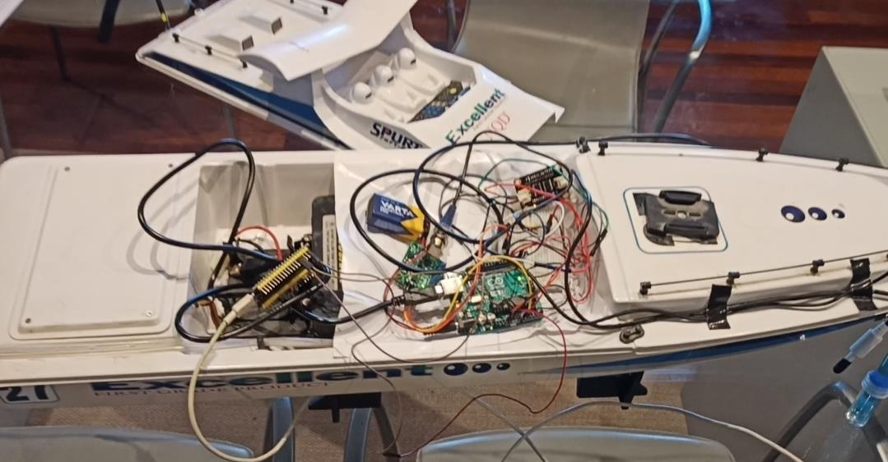
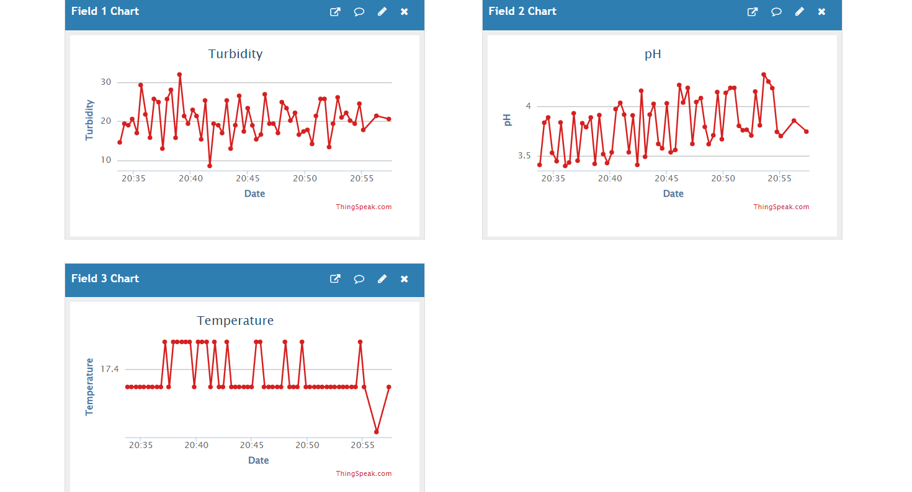
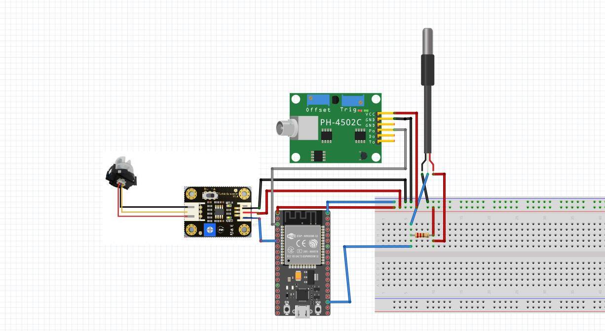

# Water Quality Monitoring System – IoT boat

IoT system that measures water quality from a small remote-controlled boat. An ESP32 reads **temperature, pH and TDS (total dissolved solids)** sensors, sends the readings over Wi-Fi to the **ThingSpeak** cloud, and a **Streamlit** dashboard in Python displays and analyses the data.

Team project for the Computer Science course of the Industrial Technologies Engineering degree at Tecnun – University of Navarra (2nd year, May 2024).



## How it works
```
Sensors (pH, TDS, temperature) → ESP32 → Wi-Fi → ThingSpeak cloud → Streamlit dashboard (Python)
```
1. **Hardware:** a DS18B20 temperature probe, a PH-4502C pH sensor and a Gravity TDS sensor, all calibrated with buffer solutions and wired to an ESP32 mounted on the boat.
2. **Firmware (C++/Arduino):** the ESP32 reads the sensors, applies temperature compensation to the TDS reading and uploads the three values to a ThingSpeak channel every 20 seconds.
3. **Dashboard (Python):** a Streamlit app downloads the latest readings from the ThingSpeak API and shows:
   - interactive time series for temperature, TDS and pH (Plotly), with adjustable time range,
   - the boat's location on a map (Folium),
   - a table with the measurement history,
   - a pH vs. TDS scatter plot with a linear regression.

| ThingSpeak channel | ESP32 wiring |
|---|---|
|  |  |

> In the dashboard and in ThingSpeak, the TDS reading appears as "Turbidity".

## Tech stack
**Hardware:** ESP32, DS18B20, PH-4502C, Gravity TDS sensor
**Firmware:** C++ (Arduino IDE), ThingSpeak library, OneWire / DallasTemperature, GravityTDS
**Software:** Python, Streamlit, Pandas, Plotly, Folium, ThingSpeak REST API

## Repository structure
```
firmware/TSD_TEMP_PH_esp32/   ESP32 sketch + secrets.example.h
dashboard/app.py              Streamlit dashboard
images/                       Photos, wiring diagrams and screenshots
```

## How to run
**Firmware**
1. Copy `firmware/TSD_TEMP_PH_esp32/secrets.example.h` to `secrets.h` in the same folder and fill in your Wi-Fi network, ThingSpeak channel ID and write API key.
2. Open the sketch in the Arduino IDE, install the libraries listed above and upload it to the ESP32.

**Dashboard**
```bash
pip install -r requirements.txt
export THINGSPEAK_CHANNEL_ID="your-channel-id"
export THINGSPEAK_READ_API_KEY="your-read-api-key"
streamlit run dashboard/app.py
```
On Windows (PowerShell) use `$env:THINGSPEAK_READ_API_KEY="..."`.

## Credentials removed
The original version had the Wi-Fi network name and password and the ThingSpeak read and write API keys written directly in the code. **They have been removed from this public version:**
- anyone reading a public repository could use the write key to send fake data to the channel, or the read key to access it;
- a Wi-Fi password should never be published, especially if it is reused elsewhere;
- credentials belong outside the source code. The firmware now reads them from a local `secrets.h` file and the dashboard from environment variables. Neither is uploaded to GitHub.

For the same reason, the project report is not included: it reproduces the original code with the credentials.

## Team
Group 9: Felipe Sevillano · Iñigo Bañuls · Jose Navarro
